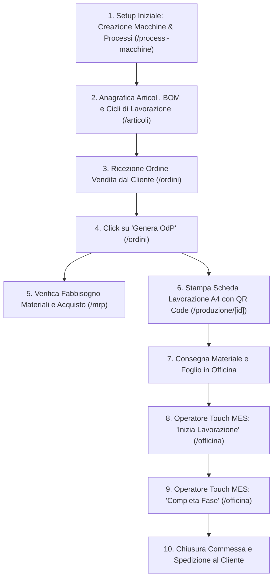

# MachinaFlow - Manuale Operativo Utente (PCP & MES Industriale)
*Versione 1.0.0 — Documento Ufficiale di Gestione della Produzione*

---

## 📌 Indice dei Contenuti
1. [Panoramica e Accesso al Sistema](#1-panoramica-e-accesso-al-sistema)
2. [Configurazione Macchine e Processi (`/processi-macchine`)](#2-configurazione-macchine-e-processi-processi-macchine)
3. [Articoli, Distinta Base (BOM) e Cicli di Lavoro (`/articoli`)](#3-articoli-distinta-base-bom-e-cicli-di-lavoro-articoli)
4. [Ordini Clienti & Vendite (`/ordini`)](#4-ordini-clienti--vendite-ordini)
5. [Fabbisogno Materiali - MRP Semplificato (`/mrp`)](#5-fabbisogno-materiali---mrp-semplificato-mrp)
6. [Ordini di Produzione & Scheda di Lavoro Stampabile A4 con QR (`/produzione`)](#6-ordini-di-produzione--scheda-di-lavoro-stampabile-a4-con-qr-produzione)
7. [Terminale Touch di Bordo Macchina - MES (`/officina`)](#7-terminale-touch-di-bordo-macchina---mes-officina)
8. [Dashboard di Controllo Carico & KPI (`/`)](#8-dashboard-di-controllo-carico--kpi-)
9. [Flusso Operativo Standard (Dalla Vendita alla Spedizione)](#9-flusso-operativo-standard-dalla-vendita-alla-spedizione)
10. [Registro delle Modifiche (Changelog del Manuale)](#10-registro-delle-modifiche-changelog-del-manuale)

---

## 1. Panoramica e Accesso al Sistema

**MachinaFlow** è un sistema integrato di Pianificazione e Controllo della Produzione (PCP), Distinta Base (BOM), Fabbisogni Materiali (MRP) e Avanzamento di Officina (MES).

- **Indirizzo di Accesso Locale:** `http://localhost:3005`
- **Dispositivi Supportati:**
  - Computer Desktop / Ufficio Tecnico (Browser Google Chrome, Edge, Safari, Firefox).
  - Tablet e Smartphone di Reparto (Installabile come Progressive Web App / PWA con layout touch-friendly ad alto contrasto per ambienti industriali).
- **Stampa Schede:** Ottimizzata per stampanti laser A4 d'officina o salvataggio in PDF (tramite il pulsante dedicato o `Ctrl+P`).

---

## 2. Configurazione Macchine e Processi (`/processi-macchine`)

In questa sezione si definiscono le fondamenta produttive dello stabilimento. È accessibile dalla voce **"Processi & Macchine"** nella barra laterale.

### A. Gestione Centri di Lavoro / Macchine
Rappresentano le risorse fisiche dell'officina (centri di lavoro CNC, torni, taglierine laser, banchi di montaggio/sbavatura, stazioni CAD/CAM).

1. **Inserimento di una Nuova Macchina:**
   - Cliccare sul pulsante **"+ Nuova Macchina / Risorsa"**.
   - Compilare i seguenti campi obbligatori:
     - **Codice Univoco:** Breve sigla identificativa (es. `MC-05`, `TORN-02`, `LASER-01`).
     - **Reparto Operativo:** Reparto di appartenenza (es. *Fresatura, Taglio Lamiera, Finitura, Collaudo*).
     - **Nome Completo Macchina:** Descrizione esatta (es. *Centro di Lavoro Verticale 5 Assi Mazak Variaxis*).
     - **Capacità Giornaliera (Ore/Giorno):** Numero di ore lavorative teoriche della macchina al giorno (es. `8.00` per turno singolo standard, `16.00` per doppio turno). Questo valore è utilizzato dalla Dashboard per calcolare il carico settimanale.
     - **Costo Orario Standard (€/h):** Tariffa oraria per il calcolo dei costi industriali (es. `75.00`).
     - **Casella "Attiva":** Selezionata per rendere la macchina disponibile per la pianificazione degli ordini.
   - Cliccare su **"Registra Macchina"**.

2. **Modifica e Disattivazione:**
   - Per modificare parametri o orari di una macchina, cliccare sul pulsante **"Modifica"** sulla card della risorsa.
   - Cliccando sull'icona a forma di spunta verde/croce grigia in alto a destra della card è possibile disattivare o riattivare istantaneamente una risorsa (es. macchina in manutenzione straordinaria).

### B. Gestione Tipi di Processo / Fasi di Lavorazione
Rappresenta il catalogo delle lavorazioni che l'azienda è in grado di eseguire.

1. **Creazione di un Nuovo Processo:**
   - Passare alla scheda **"Tipi di Processo / Fasi"**.
   - Cliccare su **"+ Nuovo Tipo di Processo"**.
   - Inserire:
     - **Codice Operazione:** (es. `PROC-PIEGATURA`, `PROC-SALDATURA`).
     - **Nome Operazione:** (es. *Piegatura Lamiera CNC*, *Saldatura TIG*).
     - **Colore Badge:** Selezionare una tinta identificativa per riconoscere visivamente la fase nei tabelloni.
     - **Macchina Predefinita:** (Opzionale) Centro di lavoro solitamente impiegato per questa operazione.
     - **Descrizione:** Istruzioni generiche di buona prassi o tolleranze generali.
   - Cliccare su **"Crea Processo"**.

---

## 3. Articoli, Distinta Base (BOM) e Cicli di Lavoro (`/articoli`)

Questo modulo costituisce il cuore dell'anagrafica tecnica dei prodotti e delle materie prime.

### A. Inserimento di un Nuovo Articolo
1. Cliccare su **"+ Nuovo Articolo"**.
2. Compilare:
   - **Codice Articolo:** Codice univoco gestionale (es. `FLG-6082-A`, `BAR-ALU-60`, `VITE-M6`).
   - **Tipologia Prodotto:**
     - *Prodotto Finito:* Oggetto vendibile al cliente finale (possiede Distinta Base e Ciclo di Lavorazione).
     - *Semilavorato:* Oggetto intermedio lavorato internamente ma destinato all'assemblaggio.
     - *Materia Prima / Componente:* Materiale da acquistare dai fornitori (barre, lamiere, viti, o-ring).
   - **Unità di Misura:** `pz`, `kg`, `m`, `l`, ecc.
   - **Giacenza Attuale:** Quantità fisicamente presente a magazzino.
   - **Scorta Minima:** Soglia di sicurezza sotto la quale il sistema genererà allarmi di riordino nell'MRP.
   - **Prezzo di Riferimento (€):** Prezzo di vendita stimato o costo medio d'acquisto.
3. Cliccare su **"Crea Articolo"**.

### B. Configurazione Distinta Base (BOM) e Ciclo di Lavorazione
Per i Prodotti Finiti e i Semilavorati, cliccare sul pulsante **"Configura BOM & Ciclo →"** presente sulla scheda dell'articolo per accedere alla vista `/articoli/[id]`.

#### 1. Distinta Base (BOM - Bill of Materials)
Indica quali materie prime o componenti servono per produrre **1 singola unità** dell'articolo padre.
- Cliccare su **"+ Aggiungi Componente / Materia Prima"**.
- **Ricerca Istantanea con Filtro Live (Novità v1.2.0):** Invece di scorrere una lunga lista, digita una qualsiasi parte del codice, della misura o della descrizione (es: `120`, `inox`, `barra`, `6082`, `M6`). Il sistema filtrerà all'istante i materiali mostrando codice, descrizione, unità di misura e giacenza a magazzino.
- **Creazione Rapida "On-The-Fly":** Se il materiale non esiste ancora, clicca su **"+ Non esiste? Crea al volo"** per registrarlo istantaneamente senza uscire dalla schermata.
- **Quantità Necessaria per Fabbricare 1 Pezzo:** Inserisci il consumo per una singola unità finita (es: se la barra è gestita in metri, per 120 mm scrivi `0.12`; se è viteria, scrivi `4` per 4 viti). Il gestionale moltiplicherà poi automaticamente questo fabbisogno unitario per la quantità di ogni ordine cliente.
- Inserire eventuali note di prelievo (es. *"Spezzone tagliato a 120mm"*).
- Cliccare su **"Aggiungi alla Distinta"**.

#### 2. Ciclo di Lavorazione (Routing & Tempi)
Definisce la sequenza temporale e tecnica dei reparti e delle macchine che lavoreranno il pezzo.
- Cliccare su **"+ Aggiungi Fase di Lavorazione"**.
- Compilare:
  - **Sequenza:** Valore numerico per stabilire l'ordine cronologico (es. `10`, `20`, `30`, `40`).
  - **Tipo di Processo:** Selezionare l'operazione (es. *Tornitura CNC, Fresatura, Sbavatura*).
  - **Nome Fase Esecutiva:** Nome chiaro per l'operatore (es. *Sgrossatura da Barra*, *Foratura Flangia*).
  - **Centro di Lavoro / Macchina:** Risorsa assegnata alla lavorazione.
  - **Tempo Attrezzaggio (Minuti Setup):** Tempo fisso *una tantum* per preparare la macchina, caricare il programma e azzerare gli utensili (es. `20` minuti).
  - **Tempo Ciclo Pezzo (Minuti/pz):** Tempo esatto impiegato dalla macchina per completare un singolo pezzo (es. `6` minuti/pezzo).
  - **Note Operative:** Prescrizioni tecniche specifiche (es. *"Alesare foro centrale con tolleranza H7"*).
- Cliccare su **"Salva Fase Ciclo"**.
- *Nota di calcolo:* Il riquadro in alto mostrerà automaticamente il tempo totale di ciclo calcolato per lotti dimostrativi (es. lotto da 10 pezzi).

---

## 4. Ordini Clienti & Vendite (`/ordini`)

Gestisce le vendite e funge da ponte verso l'officina.

1. **Creare un Ordine Cliente:**
   - Cliccare su **"+ Nuovo Ordine Cliente"**.
   - Inserire il **Numero Ordine** (il sistema propone un progressivo automatico es. `ORD-2026-003`).
   - Impostare la **Data Consegna Concordata** (tassativa per il calcolo delle scadenze).
   - Selezionare un cliente già registrato oppure digitare il nome del **Nuovo Cliente**.
   - Selezionare l'**Articolo Ordinato**, la **Quantità** e il **Prezzo Unitario**.
   - Cliccare su **"Registra Ordine Cliente"**.

2. **Lanciare la Produzione (Generazione OdP automatica):**
   - Nella lista ordini comparirà la nuova commessa in stato *"confermato"*.
   - Cliccare sul pulsante arancione **"Genera Ordine di Produzione (OdP)"**.
   - **Cosa fa il sistema istantaneamente:**
     1. Assegna un numero di commessa univoco (es. `ODP-2026-002`).
     2. Clona il ciclo di lavoro dell'articolo calcolando automaticamente per ogni fase il tempo totale stimato con la formula:  
        $$\text{Tempo Stimato Totale (min)} = \text{Tempo Attrezzaggio} + (\text{Tempo Ciclo Pezzo} \times \text{Quantità Ordinata})$$
     3. Genera il token crittografico per il **QR Code** della scheda d'officina.
     4. Aggiorna lo stato dell'ordine cliente a *"In Produzione"*.

---

## 5. Fabbisogno Materiali - MRP Semplificato (`/mrp`)

Questo modulo risponde alla domanda: *"Abbiamo abbastanza materiale in officina per completare tutti gli ordini attivi, oppure dobbiamo ordinare ai fornitori?"*.

### Come leggere la Matrice MRP:
- **Giacenza Attuale:** Quanto materiale è fisicamente in magazzino.
- **Fabbisogno Lordo OdP:** Somma delle quantità di materiale richieste da tutti gli OdP aperti (non completati).
- **Scorta Minima:** Livello di riserva di sicurezza dell'azienda.
- **Fabbisogno Netto da Ordinare:**  
  $$\text{Fabbisogno Netto} = \max(0, \text{Fabbisogno Lordo} + \text{Scorta Minima} - \text{Giacenza Attuale})$$

### Indicatori di Stato:
- 🔴 **ORDINA SUBITO (Critico):** La giacenza attuale non è sufficiente neanche a coprire i pezzi degli OdP attuali. La produzione rischia il blocco se non si acquista immediatamente.
- 🟡 **SOTTO SCORTA (Attenzione):** C'è materiale per completare gli OdP in corso, ma a fine produzione la giacenza scenderà sotto la scorta minima di sicurezza. È consigliato un riordino preventivo.
- 🟢 **OK DISPONIBILE:** Scorte ampiamente sufficienti.

*Funzione Stampa Lista Riordino:* Cliccando sul pulsante **"Stampa Lista Riordino"** in alto a destra, viene generata una tabella pulita pronta per l'Ufficio Acquisti.

---

## 6. Ordini di Produzione & Scheda di Lavoro Stampabile A4 con QR (`/produzione`)

In questa sezione si monitorano le commesse e si stampano i "fogli di viaggio" fisici da portare in officina insieme ai materiali.

1. **Elenco OdP (`/produzione`):**
   - Mostra tutti gli OdP, le priorità (Urgente, Alta, Media, Bassa), la data di consegna pianificata e la percentuale di completamento delle fasi.
   - Cliccare su **"Stampa Scheda Lavoro (QR) →"** per aprire il dettaglio dell'OdP.

2. **Dettaglio & Stampa Scheda Lavoro (`/produzione/[id]`):**
   - **QR Code Dinamico:** Generato ad alta risoluzione. Contiene il codice OdP, il token e il codice articolo. Può essere scansionato tramite fotocamera/lettore per richiamare la lavorazione sul terminale touch.
   - **Tabella delle Fasi:** Riporta l'esatta sequenza (10, 20, 30...), la macchina assegnata, i tempi previsti, le caselle per segnare l'ora di inizio/fine e lo spazio per la firma fisica dell'operatore.
   - **Pulsante "Stampa Scheda Lavoro (A4 Print-Ready)":**  
     Apre il modulo di stampa del browser. Grazie agli stili industriali `@media print`, la stampa:
     - Rimuove automaticamente menu laterale, intestazioni web e pulsanti.
     - Formatta l'intero foglio in un layout professionale in bianco e nero perfetto per fogli cartacei A4.

---

## 7. Terminale Touch di Bordo Macchina - MES (`/officina`)

Questa interfaccia è specificamente ottimizzata per l'uso su tablet posizionati a bordo macchina o smartphone degli operatori.

### Modalità Operativa Touch (3 passaggi):
1. **Filtro Macchina:** L'operatore seleziona la propria postazione cliccando sul pulsante della sua macchina (es. *"MC-01 - Mazak 5 Assi"*). Il display mostrerà immediatamente solo i pezzi in coda per quella macchina.
2. **Inizio Lavorazione:**
   - Quando l'operatore ritira il pezzo o la cassa di materiale, individua la fase corrispondente (o digita il codice OdP nel campo di ricerca/scansione) e preme il pulsante verde gigante **`▶ INIZIA LAVORAZIONE`**.
   - La fase entra nello stato **"IN MACCHINA"** (sfondo blu a luce pulsante), registrando l'ora esatta di avvio.
3. **Conclusione Lavorazione:**
   - Al termine della lavorazione del lotto, l'operatore preme **`✔ COMPLETA FASE`**.
   - Il pezzo viene registrato come lavorato e passa automaticamente alla fase successiva (es. inviato al banco sbavatura o al collaudo).
   - Se tutte le fasi della scheda vengono completate, l'intero OdP viene automaticamente contrassegnato come **"Completato"**.
4. **Note Operatore / Segnalazioni:**
   - Cliccando su **"+ Aggiungi Nota Operatore"**, l'operaio può annotare qualsiasi anomalia o rilievo tecnico (es. *"Sostituito inserto toroidale per usura dopo 10 pezzi; quota diametro 60 H7 verificata con alesametro"*).

---

## 8. Dashboard di Controllo Carico & KPI (`/`)

Fornisce alla direzione e al capo officina una visione sinottica dell'intero stabilimento.

- **KPI Principali:**
  - *Ordini di Produzione Attivi:* Quante commesse sono aperte in fabbrica.
  - *Carico Lavoro Stimato OdP:* Somma complessiva delle ore uomo/macchina stimate per evadere gli ordini aperti e quante ore sono già state effettivamente lavorate.
  - *Materiali Sotto Scorta:* Numero di articoli in deficit che richiedono attenzione acquisti.
  - *Commesse Chiuse:* Conteggio dei lotti terminati con successo.
- **Carico Attuale dei Centri di Lavoro & Macchine:**
  - Per ciascuna macchina calcola le ore di lavoro prenotate dagli OdP aperti rispetto alla capacità settimanale.
  - **Barre di Progresso a Colori:**
    - 🟢 *Verde (< 75%):* Macchina con capacità disponibile per accettare nuovi ordini.
    - 🟡 *Giallo (75% - 90%):* Macchina a carico sostenuto.
    - 🔴 *Rosso (> 90%):* Macchina sovraccarica; suggerisce di riprogrammare i turni o anticipare i lotti critici.

---

## 9. Flusso Operativo Standard (Dalla Vendita alla Spedizione)

---

## 10. Registro delle Modifiche (Changelog del Manuale)

Questo registro viene aggiornato progressivamente ad ogni modifica dell'applicazione:

| Versione | Data | Descrizione Modifiche / Nuove Funzionalità |
| :--- | :--- | :--- |
| **v1.2.1** | *22 Ottobre 2026* | - **Supporto Decimale Universale (Punto e Virgola):** Risolto il reset a zero durante la digitazione di numeri decimali sul tastierino numerico (es. 1.5 o 1,5). Il sistema ora accetta indifferentemente punto o virgola senza cancellare il testo digitato e converte automaticamente il valore al salvataggio. |
| **v1.2.0** | *22 Ottobre 2026* | - **Selettore Intelligente con Ricerca Istantanea / Filtro Digitato:** Sostituito il menu a tendina classico della distinta base con un motore di ricerca a digitazione live (filtra per codice, descrizione, misure e materiali in tempo reale). - **Chiarimento Consumo Unitario:** Riformulata l'etichetta di inserimento quantità con visualizzazione automatica dell'unità di misura e suggerimenti pratici per la conversione (es. 0.12 m per 120 mm). |
| **v1.1.0** | *22 Ottobre 2026* | - **Creazione On-The-Fly in Distinta Base (BOM):** Aggiunta la possibilità di creare e registrare immediatamente nuovi componenti/materie prime direttamente dalla finestra modale della distinta base senza dover interrompere il lavoro o navigare altrove. - Sincronizzazione automatica del nuovo componente registrato con l'Anagrafica Articoli e con la Matrice di Calcolo Fabbisogni MRP. |
| **v1.0.0** | *22 Ottobre 2026* | - Creazione architettura completa Next.js App Router, Tailwind e PWA. - Implementazione schema PostgreSQL e RLS per Supabase. - Rilascio modulo Processi e Centri di Lavoro configurabili. - Rilascio modulo Anagrafica Articoli con Distinta Base (BOM) e Routing cicli. - Rilascio modulo Ordini Clienti con generazione automatica OdP in 1-click. - Rilascio modulo Fabbisogno Materiali (MRP) con matrice deficit e riordino. - Rilascio Scheda di Lavorazione A4 Print-Ready con QR Code dinamico. - Rilascio Terminale Touch Officina (MES) per avanzamento fasi a bordo macchina. - Rilascio Dashboard con carichi macchina in tempo reale e KPI. |

---
*Fine documento — MachinaFlow PCP & MES Industriale*
